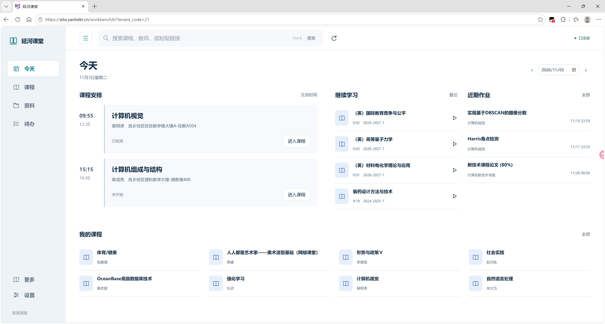
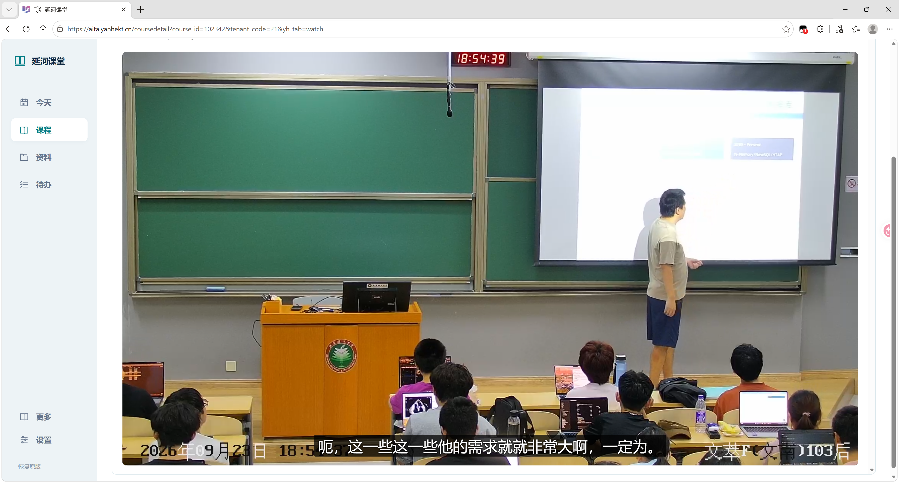
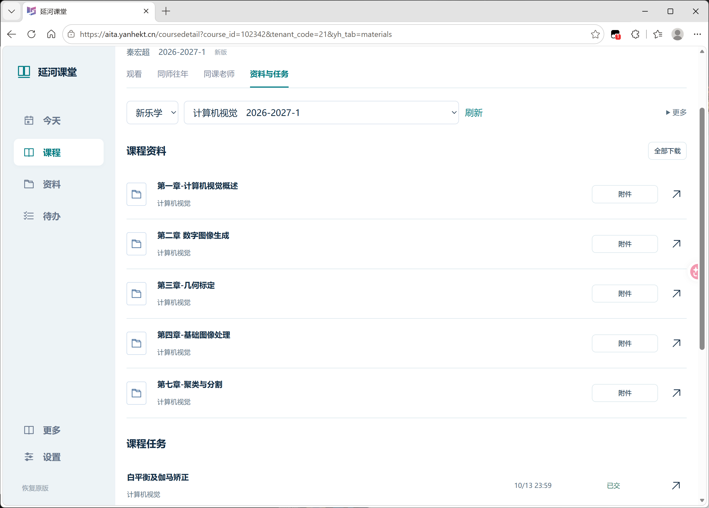
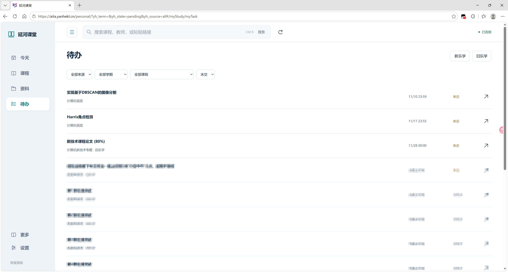

# 延河焕新

在新版、旧版延河课堂中，一站查看课程、直播、回放、资料和待办。支持 Edge / Chrome。

[下载插件 1.10](https://github.com/1whoarei1/yanhe-refine/releases/latest) · [下载旧版课次目录](https://github.com/1whoarei1/yanhe-refine/releases/latest/download/legacy-session-index.json) · [更新记录](CHANGELOG.md)

**1.10 推荐更新。** 课程目录免导入，播放设置更简洁，改善作业读取、内存占用和滚动体验。

## 功能

- 搜索课程、教师或粘贴课程链接，查找往年回放。
- 双画面观看；直播支持三画面，左侧主画面、右侧上下两路。声音来源单独选择。
- 倍速、字幕、音量、网页全屏和屏幕全屏；侧栏、课次栏与字幕表可收起。
- 汇总新旧乐学的资料与待办，按学期筛选；视频下载在独立标签页进行。
- 签到模式显示最新缓存画面，不自动签到；可随时切回原站。
- 设置中可检查四个平台的连接状态、检查插件更新，访问 AutoSlides 与 BITShare。

## 界面预览

查看更多：回放、资料与待办

**回放与字幕**

**课程资料**

**待办汇总**

## 安装与更新

1. 下载插件压缩包，解压到固定文件夹。
2. 打开 `edge://extensions` 或 `chrome://extensions`，开启「开发者模式」，选择「加载解压缩的扩展」。
3. 选择含 `manifest.json` 的文件夹，登录[新版课堂](https://aita.yanhekt.cn/)或[旧版课堂](https://www.yanhekt.cn/)即可使用。

更新时可在设置中「检查更新」，下载新版后替换原扩展文件，重新加载扩展，再刷新课堂页面。使用乐学资料与待办前，请分别登录新乐学和旧乐学。

## 课程目录

新版课程和旧版课次目录随插件内置，首次打开即可使用，无需手动导入。观看仍需登录课堂。

设置中仍可手动导入更新目录。插件更新会保留已导入的更新数据。

## 致谢

感谢 [bit-admin / Yanhekt-AutoSlides](https://github.com/bit-admin/Yanhekt-AutoSlides) 提供旧版课次索引器，感谢 [mmck111 / yanhekt-player](https://github.com/mmck111/yanhekt-player) 提供往年回放读取思路，以及 [yanhekit](https://github.com/windlandneko/yanhekit) 和下载工具作者提供协议参考。

[MIT 许可证](LICENSE) · [第三方声明](THIRD_PARTY_NOTICES.md) · [独立回放助手](https://github.com/1whoarei1/yanhe-replay) · [接口参考](https://github.com/1whoarei1/yanhe-api-reference) · [BITShare 资料分享站](https://bitshare.com.cn/)
